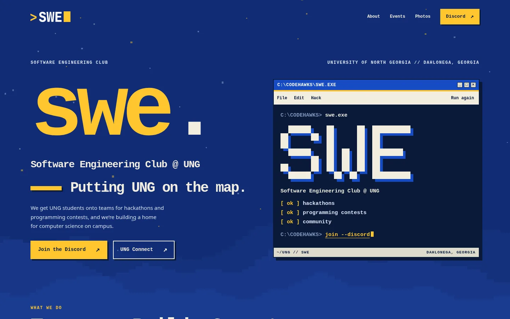

<div align="center">

# swe.

**The website of the Software Engineering Club @ UNG.**

Hackathons, programming contests and a CS community at the University of North Georgia in Dahlonega.

[**codehawks.org**](https://codehawks.org/) · [Discord](https://discord.gg/RQ6xCMpRQm) · [UNG Connect](https://connect.ung.edu/organization/app-development-club-of-ung--dah-) · [Hacklonega](https://hacklonega.dev/)



</div>

## About

One static page that says who we are, shows where we've been, and points you at the Discord. It has no accounts, forms, cookies or analytics.

It replaces an earlier Windows XP themed member platform (teams, projects, sign-in) that Discord made redundant. That version is in this repository's history, and its backend is archived at [CodeHawks-Backend](https://github.com/Israel-Jauregui/CodeHawks-Backend).

## Run it

```sh
npm ci
npm run dev
```

`npm run lint` and `npm test` are what CI runs. `npm test` builds the site first, then checks the content files and the built page.

## Change it

| To change | Edit |
| --- | --- |
| The club's name, links or email | `src/constants/club.ts` |
| The events, their dates and results | `src/constants/events.ts` (dates as `{ start: '2026-10-09', end: '2026-10-11' }`) |
| The questions and answers | `src/constants/faq.ts` |
| Who's in an event's photos | Add the person to `src/constants/members.ts` (name and LinkedIn), then list their id in the event's `members` in `src/constants/events.ts` |
| Photos | Drop originals in `photos-src/<event>/`, run `npm run photos`, describe each one in `photos-src/<event>/captions.json`, run it again |
| The page | `src/App.tsx` and `src/styles.css` |
| The link preview image | `brand/og.html`, then re-render it ([how](docs/RUNBOOK.md#link-preview-image)) |

Merging to `main` builds the site and, after an approval in GitHub, publishes it. Everything else is in [docs/RUNBOOK.md](docs/RUNBOOK.md).

## How it's built

| | |
| --- | --- |
| Site | React 19, TypeScript and Vite, prerendered to static HTML. Hand-written CSS, system fonts, no runtime dependencies besides React |
| Look | The Typewriter look from the [club styling guide](https://github.com/Software-Engineering-Club-UNG/club-styling-guide), with components carried over from [hacklonega.dev](https://github.com/Israel-Jauregui/Hacklonega) |
| Hosting | A private S3 bucket behind CloudFront, with a strict Content Security Policy |
| Infrastructure | AWS CDK in [`infra/`](infra) |
| DNS | Cloudflare, kept by hand ([the records](docs/RUNBOOK.md#dns)) |
| Deploys | GitHub Actions with short-lived AWS credentials (OIDC) behind approval gates. No AWS keys are stored anywhere |

## Repository

| Path | What's there |
| --- | --- |
| `src/` | The page, its components and the content files |
| `photos-src/` | Photo captions. The originals you drop here stay on your machine |
| `public/` | Published as is: web-ready photos, icons, the 404 page |
| `scripts/` | The prerender step and the photo converter |
| `tests/` | Content and built-page checks |
| `infra/` | The CDK app, its CloudFront Function and their tests |
| `docs/` | [Runbook](docs/RUNBOOK.md), [SEO checklist](docs/SEO.md), [asset provenance](docs/ASSET-PROVENANCE.md) |

## Credits

Made by the [Software Engineering Club](https://github.com/Software-Engineering-Club-UNG) at the University of North Georgia. The club is a student organization; this is not an official university site.
